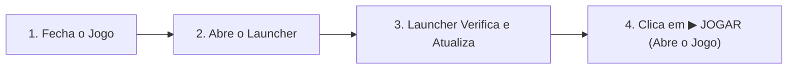
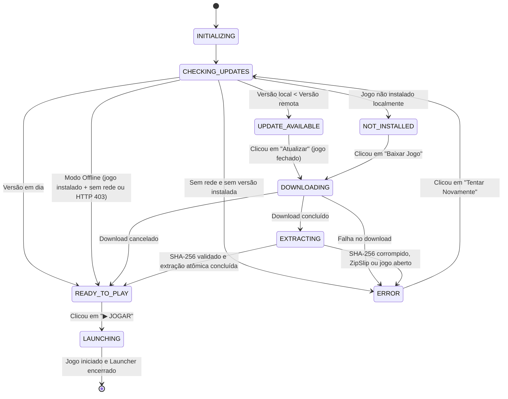

# Launcher & Auto-Updater: Cepas Selvagens

Este documento detalha o funcionamento, arquitetura, modelo de segurança e processo de lançamento do **Launcher Oficial de Cepas Selvagens**, desenvolvido como um subprojeto Godot leve e desacoplado em `launcher/`.

---

## 1. Visão Geral e Fluxo do Jogador

O Launcher é o ponto de entrada oficial para os jogadores de *Cepas Selvagens*. Em vez de exigir downloads manuais repetidos a cada atualização, o Launcher implementa o seguinte ciclo de vida:



### Detecção de Processo Ativo
Antes de iniciar downloads ou aplicar modificações de arquivos em disco, o Launcher verifica ativamente se o executável do jogo (`CepaSelvagem.exe`) está em execução no sistema operacional. Caso esteja aberto, solicita amigavelmente que o jogador encerre o jogo antes de continuar, evitando bloqueios de arquivo do sistema operacional (Windows Sharing Violation).

### Modo Offline Resiliente
Caso o jogador esteja sem internet ou atinja o limite de requisições da API pública do GitHub (HTTP 403 Rate Limit), o Launcher detecta a versão local existente e libera imediatamente o botão **"▶ JOGAR"** no Modo Offline.

---

## 2. Decisões de Arquitetura e Integridade

### 2.1 Descoberta de Versões (`version_checker.gd`)
- **Consulta à API:** O Launcher consulta `https://api.github.com/repos/tarcisodev/godot-cepas-selvagens/releases?per_page=10`.
- **Decisão de Release:** A consulta avalia até 10 releases recentes por semver (utilizando `compare_versions`), aceitando tanto releases normais quanto pré-releases (ignorando rascunhos `draft`). As builds oficiais de playtest são publicadas como releases estáveis (`prerelease: false`).
- **Seleção Estrita de Assets:** O Launcher não aceita arquivos ZIP arbitrários. Ele exige a presença de:
  1. `CepaSelvagem-<versao>-windows.zip` com o nome e versão exatos da release.
  2. `manifest.json` publicado na mesma release.
- **Tratamento de Rate Limit (HTTP 403):** Respostas 403 da API do GitHub emitem aviso claro ao jogador e automaticamente oferecem a opção de jogar a versão instalada.

### 2.2 Integridade Criptográfica e Segurança (`patcher.gd`)
- **SHA-256 Obrigatório:** Todo download é validado contra o hash publicado no `manifest.json`. Se o hash esperado estiver vazio, em branco ou for divergente do hash real do arquivo baixado, o Launcher **recusa a atualização e remove imediatamente o arquivo baixado**. Hash vazio nunca é aceito.
- **Proteção contra ZipSlip:** Durante a leitura do arquivo ZIP, cada entrada é inspecionada. Entradas com `..`, caminhos absolutos (`/` ou `\`) ou letras de unidade (`C:`) são sumariamente rejeitadas, abortando o processo antes de qualquer escrita.
- **Troca Atômica com Rollback (Atomic Staging Swap):**
  1. Os arquivos são extraídos em um diretório temporário `game_staging/`.
  2. A versão atual instalada é renomeada para `game_backup/`.
  3. O diretório `game_staging/` é promovido para `game/`.
  4. Caso qualquer falha ocorra durante a promoção, o backup é restaurado automaticamente (rollback seguro).
  5. Se tudo correr bem, o backup é removido e o `version.json` é atualizado.

### 2.3 Bloqueio de Produção (`launcher_config.gd`)
- Em builds de produção (`not OS.is_debug_build()`), as variáveis `github_repo` e `custom_manifest_url` são estritamente travadas para o repositório oficial (`tarcisodev/godot-cepas-selvagens`).
- Substituições (overrides) só são permitidas quando o executável é rodado em modo de debug do motor Godot.

### 2.4 Política de Atualização do Launcher
O executável do Launcher (`CepasSelvagensLauncher.exe`) foi concebido como um cliente binário ultra-leve (~35 MB), compilado sem texturas pesadas, mapas 3D ou código de gameplay. Toda a evolução do jogo reside nos pacotes compactados do cliente (`CepaSelvagem-<versao>-windows.zip`), que o launcher baixa e instala de forma 100% transparente.

**Decisão Documentada:** O binário do Launcher é extremamente estável e só requer atualização manual em ocasiões raras (como migração de versão maior do Godot Engine ou mudança de formato do protocolo de distribuição). Quando isso ocorrer, o jogador poderá baixar a nova versão diretamente da landing page [https://cepas.tarciso.dev](https://cepas.tarciso.dev) ou da release correspondente no GitHub.

---

## 3. Estrutura do Subprojeto

```text
godot-cepas-selvagens/
├── launcher/
│   ├── project.godot              # Configuração minimalista (gl_compatibility, 960x540)
│   ├── export_presets.cfg         # Preset de export Windows Desktop
│   ├── scenes/
│   │   └── launcher_main.tscn     # Interface com notícias, barra de progresso e botão de ação
│   ├── scripts/
│   │   ├── launcher_config.gd     # Configurações de diretório, persistência e trava de segurança
│   │   ├── version_checker.gd     # Consulta de releases GitHub (per_page=10), semver e manifest.json
│   │   ├── downloader.gd          # Gerenciamento de streaming HTTP direto para disco
│   │   ├── patcher.gd             # Validação estrita SHA-256, ZipSlip shield e troca atômica
│   │   ├── game_runner.gd         # Detecção de processos em execução e inicialização do cliente
│   │   ├── launcher_controller.gd # Controlador e máquina de estados da cena visual
│   │   └── launcher_main.gd       # Controlador desacoplado e testes
│   └── tests/
│       └── test_launcher.gd       # Testes unitários do Launcher
├── run_launcher.bat               # Script Windows para rodar o launcher rapidamente
└── tests/
    └── test_launcher_integration.gd # Teste de integração acionado na suíte principal do jogo
```

---

## 4. Máquina de Estados do Launcher



---

## 5. Como Exportar e Testar

### Executar o Launcher Localmente
```bash
# Via script .bat de conveniência:
run_launcher.bat

# Ou via Godot CLI direto:
godot --path launcher
```

### Executar Testes do Launcher
```bash
# Teste unitário do subprojeto launcher:
godot --path launcher/ --headless -s res://tests/test_launcher.gd

# Teste de integração dentro da suíte global:
godot --path . --headless -s res://tests/test_launcher_integration.gd
```

### Exportar Binário do Launcher
```bash
# Cria o diretório de destino se necessário
mkdir -p build/windows launcher/build/windows

# Executa exportação via preset oficial
godot --headless --path launcher --export-release "Windows Desktop" build/windows/CepasSelvagensLauncher.exe
```

---

## 6. Passo a Passo para Lançar uma Nova Versão

Quando os desenvolvedores lançam uma nova versão do jogo, os jogadores que usam o Launcher recebem a atualização automaticamente no próximo início. Siga o roteiro:

1. **Atualizar Versão:** Em `scripts/core/network_manager.gd`, altere `GAME_VERSION = "0.1.X"`. Altere também `config/version` em `project.godot`.
2. **Atualizar Landing Page:** Altere links e menções em `site/index.html`.
3. **Validar Testes:** Execute `godot --path . --headless -s res://tests/run_all.gd` e certifique-se de que todos os 38+ testes passaram.
4. **Commit e Merge:** Faça commit, abra PR para `master` e conclua o merge.
5. **Criar e Enviar Tag:**
   ```bash
   git checkout master
   git pull origin master
   git tag -a v0.1.X -m "Release v0.1.X"
   git push origin v0.1.X
   ```
6. **Acompanhar CI:** O workflow `.github/workflows/release.yml` valida a tag contra `GAME_VERSION`, exporta o cliente e o launcher, empacota o zip, gera o `manifest.json` com o hash SHA-256 e anexa tudo na GitHub Release.
7. **Pronto!** Os jogadores só precisam fechar o jogo, abrir o Launcher, clicar em **"Atualizar"** e jogar.
