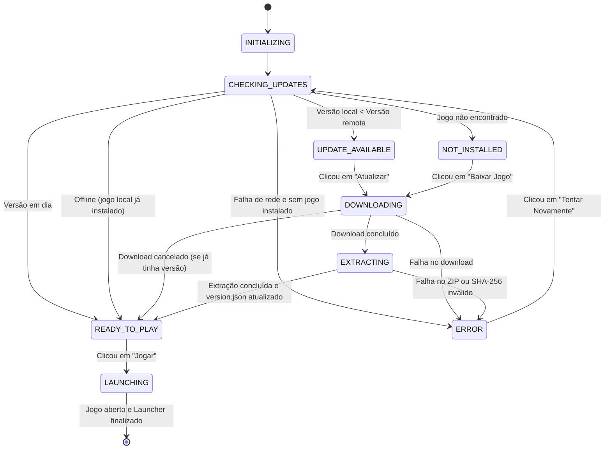

# Launcher & Auto-Updater: Cepas Selvagens

Este documento detalha o funcionamento, arquitetura e instruções de uso do **Launcher Oficial de Cepas Selvagens**, desenvolvido como um subprojeto Godot leve e desacoplado em `launcher/`.

---

## 1. Visão Geral

O Launcher resolve o problema de distribuição contínua do jogo: em vez de exigir que o jogador acesse o site ou GitHub para baixar um novo `.zip` a cada atualização, o Launcher:
1. Inicia rapidamente sem carregar assets pesados do jogo (tamanho estimado do executável: ~30-40 MB).
2. Conecta à API de Releases do GitHub (`tarcisodev/godot-cepas-selvagens`) ou a um manifesto HTTP próprio (`manifest.json`).
3. Compara a versão localmente instalada (`version.json`) com a versão mais recente via versionamento semântico (`semver`).
4. Baixa a nova versão com barra de progresso em tempo real, cálculo de velocidade (`MB/s`) e tempo restante (`ETA`).
5. Valida integridade via hash SHA-256 e extrai os arquivos diretamente no diretório do jogo (`game/`) usando `ZIPReader`.
6. Oferece o botão **"▶ JOGAR"**, que dispara o executável do jogo (`CepaSelvagem.exe`) e encerra o launcher.

---

## 2. Estrutura do Subprojeto

```text
godot-cepas-selvagens/
├── launcher/
│   ├── project.godot              # Configuração minimalista (gl_compatibility, 960x540)
│   ├── export_presets.cfg         # Preset de export Windows Desktop
│   ├── scenes/
│   │   └── launcher_main.tscn     # Interface com painel de notas, barra de progresso e botão de ação
│   ├── scripts/
│   │   ├── launcher_config.gd     # Configurações de diretório, persistência e version.json
│   │   ├── version_checker.gd     # Consulta GitHub API/Manifesto e algoritmo de comparação semver
│   │   ├── downloader.gd          # Gerenciamento de HTTPRequest com streaming direto em disco
│   │   ├── patcher.gd             # Validação SHA-256 e descompactação via ZIPReader
│   │   ├── game_runner.gd         # Localização e disparo do processo via OS.create_process()
│   │   └── launcher_controller.gd # Máquina de estados e conexão da UI com as rotinas
│   └── tests/
│       └── test_launcher.gd       # Testes unitários do Launcher
└── tests/
    └── test_launcher_integration.gd # Integração do launcher na suíte principal
```

---

## 3. Fluxo de Estados



---

## 4. Como Exportar o Launcher

### Via Godot Engine CLI (Headless)
```bash
# Na raiz do repositório:
godot --path launcher/ --headless --export-release "Windows Desktop" build/windows/CepasSelvagensLauncher.exe
```

### O que entregar ao jogador inicial
Para a primeira instalação, você só precisa entregar um único arquivo ao jogador:
- `CepasSelvagensLauncher.exe`

Ao ser aberto pela primeira vez, ele criará a pasta `game/`, detectará que o jogo não está instalado, baixará a versão mais recente do GitHub Releases e deixará o jogo pronto para jogar.

---

## 5. Como Testar

### Testes específicos do Launcher
```bash
godot --path launcher/ --headless -s res://tests/test_launcher.gd
```

### Teste de integração através da suíte principal
```bash
godot --path . --headless -s res://tests/test_launcher_integration.gd
```
