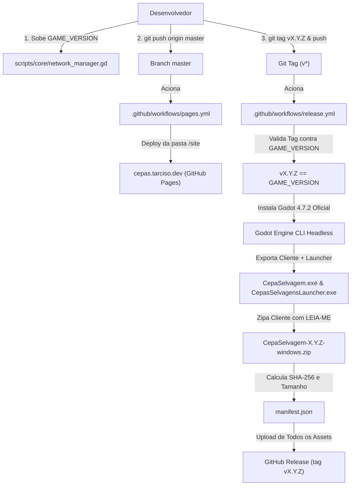

# Processo de Release e Publicação: Cepas Selvagens

Este documento estabelece o guia oficial para lançar novas versões de *Cepas Selvagens*, cobrindo o versionamento do cliente e do servidor, a compilação automatizada via GitHub Actions, a geração de manifesto com integridade SHA-256 e a publicação da landing page no GitHub Pages.

---

## 1. Visão Geral da Arquitetura de Release

O ecossistema de distribuição do jogo é 100% automatizado por workflows do GitHub:



---

## 2. Passo a Passo para Lançar uma Nova Versão

### Passo 1: Atualizar a `GAME_VERSION` no Código

O controle de versão do jogo é semântico (`MAJOR.MINOR.PATCH`) e reside em `scripts/core/network_manager.gd`:

```gdscript
# scripts/core/network_manager.gd
const GAME_VERSION: String = "0.1.1" # Atualize para a versão que será lançada
```

Atualize também a versão no arquivo de configuração do projeto:
```ini
# project.godot
[application]
config/version="0.1.1"
```

> [!IMPORTANT]
> O workflow de CI (`release.yml`) valida estritamente se a tag acionada coincide com `v${GAME_VERSION}`. Se a tag enviada for diferente da constante em `network_manager.gd`, a pipeline falhará imediatamente.

---

### Passo 2: Atualizar Menções na Landing Page (`/site/index.html`)

Atualize as menções de versão e os links no arquivo `site/index.html`:
- Link do pacote direto para Windows:
  `https://github.com/tarcisodev/godot-cepas-selvagens/releases/download/v0.1.1/CepaSelvagem-0.1.1-windows.zip`
- Rótulos dos botões e badges de versão: `v0.1.1`.

---

### Passo 3: Executar a Bateria Completa de Testes

Antes de submeter PR ou criar qualquer tag, valide toda a suíte de testes do motor e do launcher:

```bash
# Executa todos os testes unitários e de integração (38+ arquivos):
godot --path . --headless -s res://tests/run_all.gd
```
*(Todos os testes devem reportar ✅ e o processo deve retornar código 0).*

---

### Passo 4: Commit e Pull Request para `master`

De acordo com o protocolo `AGENTS.md`, trabalhe em branch derivada de `master`:

```bash
# 1. Adicione as alterações
git add scripts/core/network_manager.gd project.godot site/index.html docs/LAUNCHER.md docs/RELEASE.md

# 2. Crie o commit semântico
git commit -m "chore(release): preparar versao v0.1.1"

# 3. Envie a branch de feature
git push origin feature/launcher-release
```

Abra o Pull Request para `master`, revise as alterações e faça o merge.

---

### Passo 5: Criar e Enviar a Tag Git

Com a `master` atualizada no commit correspondente, crie a tag anotada e envie ao GitHub:

```bash
# 1. Atualize a master local
git checkout master
git pull origin master

# 2. Crie a tag anotada
git tag -a v0.1.1 -m "Release v0.1.1"

# 3. Envie a tag para o GitHub (dispara o workflow de Release)
git push origin v0.1.1
```

---

## 3. Workflows Executados no GitHub Actions

### A. Publicação do Site (`.github/workflows/pages.yml`)
- **Gatilho:** A cada push na branch `master`.
- **Ação:** Coleta os arquivos da pasta `/site` (incluindo o `CNAME` com `cepas.tarciso.dev`) e publica via GitHub Pages.
- **URL Pública:** [https://cepas.tarciso.dev](https://cepas.tarciso.dev)

### B. Compilação e Anexo de Release (`.github/workflows/release.yml`)
- **Gatilho:** Envio de tag correspondente a `v*` (ex.: `v0.1.1`).
- **Ação:**
  1. Extrai `GAME_VERSION` e valida se a tag é exatamente `v${GAME_VERSION}` (falha caso não seja).
  2. Baixa o Godot 4.7.2 oficial e os export templates oficiais do repositório `godot-builds`.
  3. Exporta o cliente do jogo (`build/windows/CepaSelvagem.exe`).
  4. Exporta o Launcher Oficial (`build/windows/CepasSelvagensLauncher.exe`). Qualquer falha na exportação do launcher interrompe e falha o job.
  5. Empacota o cliente em `CepaSelvagem-${GAME_VERSION}-windows.zip`.
  6. Gera o `manifest.json` com `version`, `file`, `size` e hash criptográfico `sha256`.
  7. Assina opcionalmente o manifesto caso o segredo `RELEASE_SIGNING_KEY` esteja configurado no repositório.
  8. Cria a GitHub Release pública anexando:
     - `CepaSelvagem-${GAME_VERSION}-windows.zip`
     - `manifest.json`
     - `manifest.json.sig` (se assinado)
     - `CepasSelvagensLauncher.exe`

---

## 4. Atualização Automática nos Jogadores

Assim que a release for publicada:
1. O jogador que já possui o jogo abre o Launcher (`CepasSelvagensLauncher.exe`).
2. O Launcher consulta `/releases?per_page=10` e detecta a nova versão disponível via `semver`.
3. O Launcher baixa o pacote oficial `CepaSelvagem-0.1.1-windows.zip`.
4. O Launcher valida o hash SHA-256 contra o `manifest.json` da release.
5. Os arquivos são extraídos de forma atômica na pasta `game/`.
6. O botão **"▶ JOGAR"** é liberado, iniciando o jogo diretamente na nova versão.

---

## 5. Dúvidas Frequentes

### Como deletar uma tag criada incorretamente?
Se precisar corrigir uma tag antes do lançamento oficial:
```bash
# Deleta localmente
git tag -d v0.1.1

# Deleta no GitHub
git push origin --delete v0.1.1
```

### O que fazer se o Windows SmartScreen avisar sobre executável desconhecido?
Por se tratar de software independente sem certificado de assinatura paga da Microsoft, o SmartScreen pode alertar usuários de primeira viagem. Instrua-os a clicar em **"Mais informações"** -> **"Executar assim mesmo"**.
