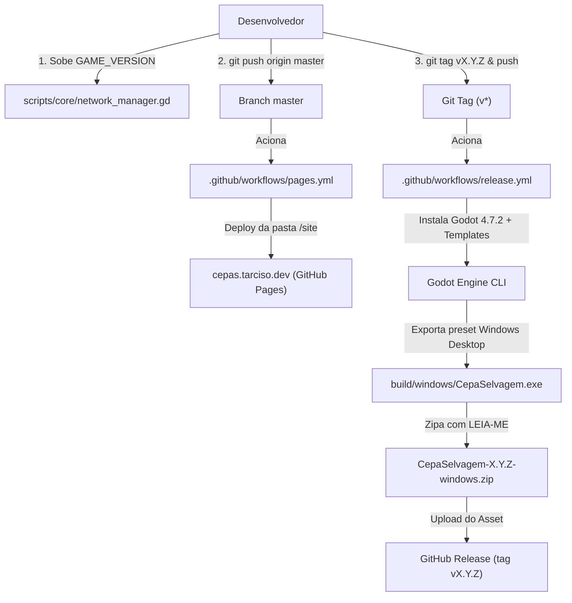

# Processo de Release e Publicação: Cepas Selvagens

Este documento estabelece o guia oficial para lançar novas versões do **Playtest Fechado** de *Cepas Selvagens*, cobrindo o versionamento do cliente e do servidor, a compilação automatizada via GitHub Actions e a publicação da landing page no GitHub Pages.

---

## 1. Visão Geral da Arquitetura de Release

O ecossistema de distribuição do jogo é 100% automatizado por workflows do GitHub:



---

## 2. Passo a Passo para Lançar uma Nova Versão

### Passo 1: Atualizar a `GAME_VERSION` no Código

O controle de versão do jogo é semântico (`MAJOR.MINOR.PATCH`) e reside em `scripts/core/network_manager.gd`:

```gdscript
# scripts/core/network_manager.gd
const GAME_VERSION: String = "0.1.0" # Altere para a nova versão desejada (ex.: 0.1.1)
```

> [!IMPORTANT]
> O servidor e o cliente validam essa constante no aperto de mão (handshake) da autenticação. Se a versão for diferente, a conexão é recusada informando amigavelmente ao jogador que ele deve atualizar o client.

---

### Passo 2: Atualizar Menções na Landing Page (`/site/index.html`)

Se a versão visível do playtest for atualizada, atualize o botão de download e os badges no arquivo `site/index.html`:
- Link do botão primário de download:
  `https://github.com/tarcisodev/godot-cepas-selvagens/releases/download/vX.Y.Z/CepaSelvagem-X.Y.Z-windows.zip`
- Rótulo do botão e badges de versão: `vX.Y.Z`.

---

### Passo 3: Executar a Bateria de Testes Automatizados

Antes de criar qualquer release ou tag, garanta que todos os testes estejam passando:

```bash
godot --path . --headless -s res://tests/run_all.gd
```
*(Todos os arquivos de teste devem reportar ✅ e o processo deve retornar código 0).*

---

### Passo 4: Fazer Commit e Push

Trabalhe de acordo com o protocolo `AGENTS.md` (em branch de feature ou fix derivando de `master`):

```bash
# Adiciona as alterações
git add scripts/core/network_manager.gd site/ docs/RELEASE.md

# Cria o commit semântico
git commit -m "chore(release): preparar versao v0.1.0 para playtest"

# Envia a branch para o GitHub
git push origin feature/minha-feature
```

Abra o Pull Request para `master` e faça o merge após a revisão.

---

### Passo 5: Criar e Enviar a Tag Git

Com a `master` atualizada no commit de release, crie uma tag anotada com o prefixo `v` correspondente à versão informada na `GAME_VERSION`:

```bash
# 1. Garanta que está na master atualizada
git checkout master
git pull origin master

# 2. Crie a tag anotada
git tag -a v0.1.0 -m "Release v0.1.0 (Playtest Fechado)"

# 3. Envie a tag para o repositório remoto no GitHub
git push origin v0.1.0
```

---

## 3. Workflows Executados Automaticamente

### A. Publicação do Site (`.github/workflows/pages.yml`)
- **Gatilho:** A cada push na branch `master`.
- **Ação:** Coleta os arquivos da pasta `/site` (incluindo o `CNAME` com `cepas.tarciso.dev`) e publica via GitHub Pages.
- **URL Pública:** [https://cepas.tarciso.dev](https://cepas.tarciso.dev)

### B. Compilação e Anexo de Release (`.github/workflows/release.yml`)
- **Gatilho:** Envio de tag correspondente a `v*` (ex.: `v0.1.0`).
- **Ação:**
  1. Extrai a versão da constante `GAME_VERSION`.
  2. Baixa o Godot 4.7.2 oficial e os export templates oficiais.
  3. Exporta o preset `"Windows Desktop"` gerando `CepaSelvagem.exe` com PCK embutido.
  4. Gera o pacote compactado `CepaSelvagem-<versão>-windows.zip` acompanhado do arquivo `LEIA-ME.txt`.
  5. Cria um GitHub Release anotado e anexa o arquivo `.zip` para download público.

---

## 4. Atualização do Servidor Dedicado (VPS)

Caso a nova versão altere scripts do servidor ou a `GAME_VERSION`:
1. Conecte-se ao VPS ou execute o script de deploy automatizado (`tools/deploy_vps.sh`).
2. Exporte a nova build do servidor (`Linux Server` -> `build/linux/cepas-server.x86_64`) e envie para o diretório `/home/cepas/cepas-server/`.
3. Reinicie o serviço systemd:
   ```bash
   sudo systemctl restart cepas-server.service
   ```
4. Verifique os logs do servidor em tempo real:
   ```bash
   journalctl -u cepas-server -f
   ```

---

## 5. Dúvidas Frequentes

### Como deletar uma tag criada incorretamente?
Se precisar corrigir uma tag antes de divulgar:
```bash
# Deleta localmente
git tag -d v0.1.0

# Deleta no GitHub
git push origin --delete v0.1.0
```

### O que fazer se o Windows SmartScreen avisar sobre executável desconhecido?
Por se tratar de software independente sem certificado de assinatura paga da Microsoft, o SmartScreen pode alertar usuários de primeira viagem. Instrua-os a clicar em **"Mais informações"** -> **"Executar assim mesmo"**.
