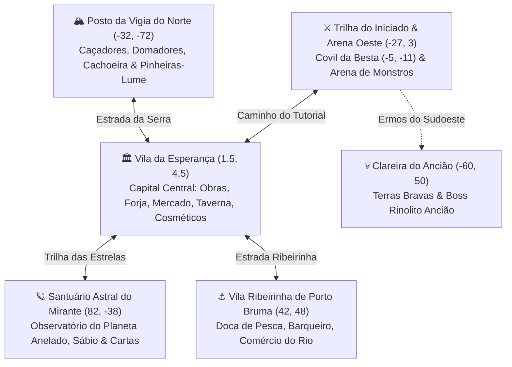

# 🗺️ Estrutura do Mundo, Cidades, Regiões e Caminho do Tutorial

> **Status:** Implementado  
> **Sistemas Relacionados:** `scripts/world/world_settlements.gd`, `scripts/world/tutorial_trail.gd`, `scripts/ui/world_map_screen.gd`, `scripts/city_hub.gd`, `scripts/core/zone_manager.gd`, `scripts/ui/explorer_guide.gd`

---

## 1. Visão Geral da Geografia do Vale (`360m × 360m`)

O mapa de **Cepa Selvagem** deixou de ter pontos isolados apenas no centro e agora está organizado em **6 grandes regiões e assentamentos conectados por estradas sinalizadas**, marcos visuais e um **Mapa Cartográfico Interativo (`[M]`)** com suporte a bússola e **Viagem Rápida (Fast Travel)**.

---

## 2. Cidades, Vilas e Assentamentos

| Assentamento | Coordenada | Papel no Jogo | NPCs e Estruturas |
| :--- | :--- | :--- | :--- |
| **🏛️ Vila da Esperança** | `(1.5, 4.5)` | Capital e Hub Central em reconstrução coletiva | Mestre Construtor (Quadro de Obras), Alquimista, Mercadora, Barbeiro, Estilista Astral (`[F9]`), Cronista (`[F8]`), Mestre de Armas, Bigorna, Fogueira e Mesa de Cartas |
| **⚓ Porto Bruma (Vila Ribeirinha)** | `(42.0, 48.0)` | Povoado pesqueiro às margens da bacia sul do rio | Píer/Doca de madeira, Fogueira Ribeirinha, Baú de Suprimentos, **Mestre Pescador Cauã** (dicas e recompensas de pesca/nado) e Marco de Viagem Rápida |
| **🏔️ Vigia do Norte (Posto da Serra)** | `(-32.0, -72.0)` | Entreposto de caçadores no platô acima da cachoeira | Guarita de madeira, Fogueira da Serra, **Guarda-Florestal Iara** (guia de captura com Laço, montarias e Pinheiras-Lume) e Marco de Viagem Rápida |
| **🪐 Santuário Astral do Mirante** | `(82.0, -38.0)` | Círculo de pedra nas colinas do leste com vista limpa do cosmos | Menires luminosos, Fogueira Estelar, **Astrônomo Celiano** (lore do Planeta com Anéis, ciclo solar/lunar e Duelo de Cepas) e Marco de Viagem Rápida |

---

## 3. O Caminho do Tutorial (`TutorialTrail` — Trilha do Iniciado)

Para que novos jogadores (solo ou jogando em família/amigos no PC e celular) entendam tudo o que existe no projeto sem ficarem perdidos ao spawnar na cidade, criamos a **Trilha do Iniciado**:

1. **Caminho Físico Iluminado no Chão**:
   - Uma sequência de **Pedras-Guia Luminosas (Balizas Douradas/Esmeralda)** liga a posição atual do jogador até a próxima Estação do Tutorial.
2. **8 Estações Adaptadas à Situação Atual do Projeto**:
   - **Passo 1 — Boas-vindas, Estilo & Cosméticos `(0.0, 3.2)`**: Apresenta a Vila da Esperança, o Barbeiro e a Loja de Cosméticos `[F9]` com o ouro inicial.
   - **Passo 2 — Suprimentos & Mochila `(3.2, 3.4)`**: Interagir com o Baú de Suprimentos `[E]` e conhecer a Mochila `[I]` / Roda Rápida `[Q]`.
   - **Passo 3 — Mestre de Armas & Combate `(1.0, 6.2)`**: Escolher entre Espada e Escudo, Martelo Pesado ou Cajado Arcano no Mestre de Armas `[E]`.
   - **Passo 4 — Coleta & Ofícios de Campo `(9.5, -4.5)`**: Sair da paliçada, colher materiais com `[E]` e abrir a Central `[TAB]` para fabricar itens.
   - **Passo 5 — O Rio Vivo, Nado & Pesca `(17.5, 4.0)`**: Conhecer a margem do rio, nado, mergulho e Vara de Pesca.
   - **Passo 6 — Caçada Anatômica à Besta de Sucata `(-5.0, -11.0)`**: Quebrar o chifre da Besta de Sucata e esfolar `[E]` o corpo.
   - **Passo 7 — Forja na Bigorna & Obras da Vila `(4.5, 4.6)`**: Forjar o Elmo Chifre-de-Pedra na Bigorna `[E]` e doar materiais no Quadro de Obras.
   - **Passo 8 — Cartas, Céu Estrelado, Mapa `[M]` & Coop `[F7]` `(-2.6, 7.4)`**: Duelo de Cartas na Taverna, olhar para o Planeta com Anéis no céu, abrir o Mapa `[M]` para viajar às outras vilas, construir com `[B]` e jogar junto via `[F7]`.
3. **Flexibilidade Total**:
   - Cada estação avança **automaticamente** ao cumprir a ação ou ao encostar no Marco da Estação e apertar `[E]`, além de permitir pular etapas pelo Guia `[J]` ou Mapa `[M]`.
